# Hospital Management — Hệ thống quản lý bệnh viện

Hospital Management là đồ án môn **Lập trình Web**, xây dựng hệ thống hỗ trợ đặt lịch và quản lý hoạt động khám bệnh tại Xet Hospital. Hệ thống kết nối bệnh nhân, bác sĩ, nhân viên tiếp nhận, kỹ thuật viên và quản trị viên trong các công việc: tiếp nhận lịch hẹn, khám và kê đơn, trả kết quả xét nghiệm, đăng ký gói khám và theo dõi hồ sơ.

**Website đã triển khai:** [Xet Hospital](https://btl-laptrinhweb-hospitalmanagement.onrender.com/)

## Thành viên thực hiện

| STT | Họ và tên | Mã sinh viên | Vai trò |
|---|---|---|---|
| 1 | Phùng Nguyễn Trọng An | 242630900 | Nhóm trưởng |
| 2 | Nguyễn Viết Khanh | 242630950 | Thành viên |
| 3 | Nguyễn Đức Mạnh | 242630961 | Thành viên |
| 4 | Lê Đức Tài | 242630972 | Thành viên |

## Sơ đồ phân tầng chức năng

```mermaid
flowchart TB
    HT["Hệ thống quản lý bệnh viện"]
    HT --> CK["Tra cứu công khai"]
    HT --> BN["Bệnh nhân"]
    HT --> BS["Bác sĩ"]
    HT --> TN["Nhân viên tiếp nhận"]
    HT --> KTV["Kỹ thuật viên"]
    HT --> QT["Quản trị viên"]

    CK --> CK1["Bác sĩ và chuyên khoa<br/>Dịch vụ, gói khám, tin tức"]
    CK --> CK2["Xem lịch làm việc<br/>Đặt lịch khám không cần tài khoản"]
    BN --> BN1["Tài khoản và hồ sơ cá nhân"]
    BN --> BN2["Đặt khám, xét nghiệm, gói khám<br/>Theo dõi và hủy lịch hẹn"]
    BN --> BN3["Xem đơn thuốc, kết quả<br/>Tải phiếu PDF"]
    BS --> BS1["Lịch làm việc<br/>Thông báo điều phối"]
    BS --> BS2["Tiếp nhận lịch khám<br/>Khám và kê đơn"]
    TN --> TN1["Lịch khám trong ngày<br/>Xác nhận hoặc hủy lịch hẹn"]
    TN --> TN2["Tiếp nhận gói khám<br/>Ghi nhận số tiền thực thu"]
    KTV --> KTV1["Danh mục xét nghiệm<br/>Tiếp nhận phiếu, ghi nhận thanh toán"]
    KTV --> KTV2["Nhập kết quả và kết luận<br/>Đính kèm kết quả PDF"]
    QT --> QT1["Thống kê tổng quan<br/>Tài khoản và phân quyền"]
    QT --> QT2["Bác sĩ, nhân viên, ca làm việc<br/>Điều phối lịch hẹn, gói khám"]
    QT --> QT3["Dịch vụ, gói khám, tin tức<br/>Thông báo cho bác sĩ"]
```

## Truy cập và đăng nhập

1. Mở địa chỉ website được cung cấp. Bản chạy trên máy cá nhân mặc định dùng **http://localhost:5080**.
2. Chọn **Đăng nhập**, nhập email và mật khẩu.
3. Chọn **Không gian của tôi** để vào phân hệ tương ứng với vai trò tài khoản.
4. Người bệnh chưa có tài khoản có thể chọn **Đăng ký bệnh nhân**. Để thay đổi thông tin hoặc mật khẩu, mở **Hồ sơ cá nhân**.
5. Chọn **Đăng xuất** khi sử dụng xong hoặc muốn chuyển sang tài khoản khác.

### Tài khoản thử

| Vai trò | Email | Mật khẩu |
|---|---|---|
| Quản trị | admin@example.com | admin123 |
| Bác sĩ | doctor@example.com | doctor123 |
| Kỹ thuật viên | diagnostic@example.com | diagnostic123 |
| Tiếp nhận | staff@example.com | staff123 |
| Bệnh nhân | patient@example.com | patient123 |

## Hướng dẫn dành cho bệnh nhân

### Đặt lịch khám

1. Chọn **Bác sĩ** để xem chuyên khoa, thông tin và lịch làm việc, hoặc chọn **Đặt lịch khám** trên thanh điều hướng.
2. Chọn bác sĩ, ngày khám và khung giờ còn trống.
3. Nhập thông tin người khám, số điện thoại, email và mô tả vấn đề cần khám; kiểm tra thông tin trước khi gửi.
4. Sau khi đặt thành công, xem mã lịch hẹn, số thứ tự, giờ khám và trạng thái trên phiếu. Có thể tải phiếu PDF để lưu lại.
5. Nếu đặt khi đã đăng nhập, mở **Không gian của tôi** để theo dõi lịch hẹn. Nếu đặt không cần tài khoản, lưu đường dẫn phiếu được mở sau khi đặt để xem lại.

Lịch hẹn mới ở trạng thái **Chờ xác nhận**. Nếu khung giờ vừa hết chỗ, chọn một khung giờ khác. Chỉ có thể hủy lịch chưa hoàn tất, chưa hủy và chưa đến giờ khám; nhập lý do khi hệ thống yêu cầu.

### Đăng ký xét nghiệm

1. Đăng nhập, chọn **Xét nghiệm**, tìm dịch vụ theo tên hoặc nhóm.
2. Xem giá dịch vụ, chọn đăng ký rồi điền ngày, giờ và thông tin liên hệ. Có thể nhập mã lịch khám thuộc tài khoản để liên kết phiếu.
3. Theo dõi phiếu tại **Không gian của tôi**. Khi kỹ thuật viên trả kết quả, mở chi tiết để xem nội dung, kết luận và tải tệp PDF đính kèm nếu có.

### Đăng ký gói khám

1. Đăng nhập, chọn **Gói khám** và xem quyền lợi, giá của gói.
2. Chọn gói, ngày khám từ ngày mai và mức đặt cọc được cung cấp trên biểu mẫu.
3. Kiểm tra mã phiếu, tổng tiền và số tiền đã thu trong trang chi tiết; có thể tải phiếu PDF.
4. Liên hệ bộ phận tiếp nhận để thanh toán. Chọn mức đặt cọc khi đăng ký chưa được tính là đã trả tiền.

### Xem hồ sơ và đơn thuốc

Mở **Không gian của tôi**, chọn lịch khám, phiếu xét nghiệm hoặc gói khám cần xem. Sau khi bác sĩ hoàn tất khám, chi tiết lịch hẹn hiển thị chẩn đoán, thuốc và lời dặn. Tải phiếu PDF để lưu thông tin. Tài khoản chỉ xem được hồ sơ thuộc quyền truy cập của mình.

## Hướng dẫn dành cho bác sĩ

1. Đăng nhập bằng tài khoản bác sĩ và mở **Không gian của tôi**.
2. Xem lịch làm việc, thông báo điều phối và danh sách lịch khám được phân công; lọc theo ngày khi cần.
3. Xác nhận lịch đang chờ trước khi khám. Nếu cần hủy, sử dụng thao tác hủy trên lịch hẹn.
4. Với lịch đã xác nhận, mở chức năng kê đơn, nhập chẩn đoán, thông tin thuốc và lời dặn.
5. Lưu đơn thuốc để hoàn tất lượt khám. Bệnh nhân có thể xem và tải phiếu sau đó.

## Hướng dẫn dành cho nhân viên tiếp nhận

1. Đăng nhập bằng tài khoản tiếp nhận, xem danh sách lịch khám trong ngày.
2. Đối chiếu mã lịch hẹn và thông tin bệnh nhân; vào danh sách lịch hẹn để xác nhận hoặc hủy theo tình hình tiếp nhận.
3. Mở danh sách phiếu gói khám, kiểm tra ngày khám, gói đã chọn và trạng thái.
4. Khi bệnh nhân thanh toán, cập nhật **số tiền thực thu** và lưu phiếu. Kiểm tra lại số tiền đã thu trước khi kết thúc thao tác.

## Hướng dẫn dành cho kỹ thuật viên

1. Đăng nhập bằng tài khoản kỹ thuật viên, mở danh sách phiếu xét nghiệm.
2. Lọc theo ngày hoặc trạng thái, kiểm tra thông tin dịch vụ và bệnh nhân.
3. Xác nhận tiếp nhận phiếu, cập nhật trạng thái thanh toán theo thực tế.
4. Với phiếu đã xác nhận, mở phần trả kết quả, nhập nội dung và kết luận. Có thể đính kèm tệp **PDF tối đa 5 MB**.
5. Lưu kết quả để hoàn tất phiếu. Bệnh nhân xem kết quả trong hồ sơ của mình.

## Hướng dẫn dành cho quản trị viên

1. Đăng nhập bằng tài khoản quản trị, mở bảng điều khiển để xem thống kê hoạt động.
2. Quản lý tài khoản: thêm, sửa thông tin, gán vai trò và khóa tài khoản khi cần.
3. Quản lý bác sĩ, nhân viên và ca làm việc; kiểm tra lịch trước khi điều phối bệnh nhân.
4. Theo dõi lịch khám, phiếu gói khám; gửi thông báo điều phối cho bác sĩ.
5. Cập nhật danh mục dịch vụ, giá và đơn vị tiền, quyền lợi gói khám; quản lý nội dung tin tức hiển thị trên website.

Khi thay đổi ca làm việc, cần kiểm tra các lịch đã đặt để điều phối phù hợp. Với tài khoản đã có hồ sơ nghiệp vụ, sử dụng chức năng khóa nếu hệ thống không cho phép xóa.

## Trạng thái phiếu và lưu ý khi sử dụng

| Trạng thái | Ý nghĩa |
|---|---|
| Chờ xác nhận / Pending | Phiếu đã được gửi, đang chờ bộ phận phụ trách tiếp nhận. |
| Đã xác nhận / Confirmed | Phiếu đã được tiếp nhận để thực hiện khám hoặc dịch vụ. |
| Hoàn tất / Completed | Đã hoàn tất lượt khám hoặc dịch vụ; kiểm tra chi tiết để xem hồ sơ. |
| Đã hủy / Cancelled | Phiếu không tiếp tục được thực hiện. |

- Lịch và giờ hẹn sử dụng giờ Việt Nam. Ngày đặt được giới hạn tối đa 90 ngày tính từ hiện tại.
- Mọi khoản phí và số tiền thanh toán sử dụng **Việt Nam đồng (VND)**. Bảng giá có sẵn là dữ liệu minh họa cho đồ án; kiểm tra giá trên phiếu trước khi đăng ký hoặc thu tiền.
- Thanh toán được nhân viên ghi nhận tại bệnh viện. Nếu hủy phiếu sau khi đã thu tiền, liên hệ bộ phận tiếp nhận để xử lý hoàn tiền.
- Nếu hệ thống báo phiếu đã thay đổi, tải lại trang để xem thông tin mới nhất trước khi thao tác tiếp.
- Nếu quên mật khẩu, chọn **Quên mật khẩu** tại trang đăng nhập. Nếu không nhận được liên kết đặt lại, liên hệ người quản trị hệ thống.
